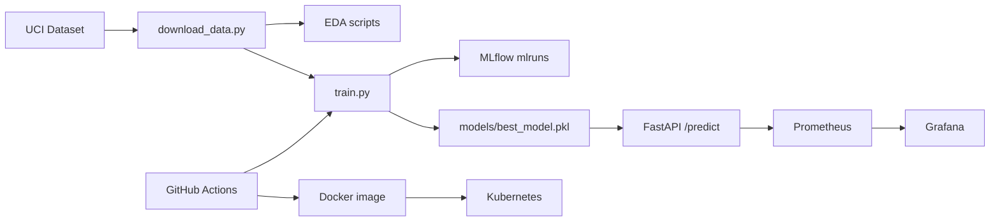

# MLOps Assignment 01 — Technical Report

**Course:** AIMLCZG523 Machine Learning Operations  
**Project:** Heart Disease Risk Classifier (UCI Cleveland)  
**Author:** _[Your Name]_  
**Date:** _[Submission Date]_  
**Repository:** _[GitHub URL]_

---

## 1. Executive summary

This project delivers a production-style ML pipeline that predicts heart disease risk from clinical features. The solution includes automated data ingestion, EDA, two tuned classifiers with cross-validation, MLflow experiment tracking, a versioned sklearn preprocessing pipeline, GitHub Actions CI/CD, a Dockerized FastAPI service, Kubernetes deployment manifests, and Prometheus-compatible metrics with optional Grafana dashboards.

---

## 2. Problem definition

**Objective:** Binary classification — predict presence (`1`) or absence (`0`) of heart disease from patient measurements.

**Dataset:** UCI Heart Disease — Cleveland subset (`processed.cleveland.data`), 14 attributes including age, sex, chest pain type, blood pressure, cholesterol, and exercise ECG results. Original target `num` is binarized: any value &gt; 0 indicates disease.

**Success criteria:** High recall on disease class (clinical safety), strong ROC-AUC, reproducible training, and a monitored HTTP API for inference.

---

## 3. Setup and installation

See repository `README.md`. Summary:

1. Create virtual environment and `pip install -r requirements.txt`.
2. Set `PYTHONPATH=src` (or use Docker, which sets this automatically).
3. Run `python scripts/download_data.py` → cleaned CSV under `data/processed/`.
4. Run `python scripts/train.py` → `models/best_model.pkl` and MLflow runs.

All steps are repeated in CI on every push.

---

## 4. Data acquisition and EDA

**Acquisition:** `scripts/download_data.py` fetches data from the UCI archive URL defined in `config.py`.

**Cleaning:**

- Missing values encoded as `?` are parsed as NaN; incomplete rows are dropped (small fraction).
- Target binarization: `target = (num > 0)`.

**EDA outputs** (`reports/figures/`):

| Artifact | Purpose |
|----------|---------|
| `class_balance.png` | Check imbalance between healthy vs disease |
| `feature_histograms.png` | Distribution shape per feature |
| `correlation_heatmap.png` | Multicollinearity and feature relationships |
| `eda_summary.txt` | Numeric describe() and counts |

**Design choices:** All features are numeric in Cleveland; no one-hot encoding required. Class weights `balanced` are used in models to mitigate mild imbalance.

_[Insert screenshot: class balance and heatmap]_

---

## 5. Feature engineering and modeling

**Pipeline:** `ColumnTransformer` + `StandardScaler` on all 13 features, coupled with the classifier inside a single sklearn `Pipeline` for leak-free CV and deployment.

**Models compared:**

1. **Logistic Regression** — interpretable baseline, `max_iter=2000`, `class_weight=balanced`.
2. **Random Forest** — non-linear boundaries, `n_estimators=200`, `max_depth=8`, tuned for stability on small tabular data.

**Evaluation:**

- 5-fold stratified cross-validation on training split (accuracy, precision, recall, ROC-AUC).
- Hold-out test set (20%, stratified, `random_state=42`).
- **Selection rule:** highest test ROC-AUC; ties broken by recall.

**Typical outcome:** Random Forest often wins on AUC; both models exceed 0.80 AUC on clean data — exact numbers are in `models/best_model_metrics.json` and MLflow.

_[Insert MLflow UI screenshot comparing runs]_

---

## 6. Experiment tracking (MLflow)

Tracking URI: local `mlruns/` (file store).

**Logged per run:**

- Parameters: model name, CV folds, test size, random state
- Metrics: CV means and hold-out test metrics
- Artifacts: full sklearn pipeline (`mlflow.sklearn.log_model`)

**Production artifact:** `models/best_model.pkl` (joblib) plus MLflow model directory `models/best_model/`.

```bash
mlflow ui --backend-store-uri mlruns
```

---

## 7. Reproducibility

| Component | Mechanism |
|-----------|-----------|
| Dependencies | Pinned `requirements.txt` |
| Randomness | `RANDOM_STATE=42` in config |
| Preprocessing | Encapsulated in sklearn Pipeline |
| Training entrypoint | `scripts/train.py` |
| CI | Same commands as local README |

---

## 8. Architecture



**Runtime path:** Client → LoadBalancer/Ingress → FastAPI → sklearn Pipeline → JSON prediction + confidence.

---

## 9. CI/CD

Workflow: `.github/workflows/ci.yml`

| Stage | Action |
|-------|--------|
| Lint | `ruff check` |
| Test | `pytest` + coverage |
| Train | `scripts/train.py`, upload MLflow + model artifacts |
| Docker | Build image, curl `/health` and `/predict` |

Pipeline **fails** on lint errors, test failures, or container smoke test failure.

_[Insert GitHub Actions success screenshot]_

---

## 10. Containerization

- **Image:** `python:3.11-slim`, installs requirements, runs download + train at build time.
- **Server:** Uvicorn + FastAPI on port 8000.
- **Endpoints:** `GET /health`, `POST /predict`, `GET /metrics`.
- **Healthcheck:** Docker `HEALTHCHECK` on `/health`.

Sample request body documented in `sample_request.json`.

_[Insert docker run + curl output screenshot]_

---

## 11. Production deployment (Kubernetes)

Manifests in `k8s/`:

- `namespace.yaml` — `heart-mlops`
- `deployment.yaml` — 2 replicas, probes, resource limits
- `service.yaml` — `LoadBalancer` on port 80 → 8000
- `ingress.yaml` — optional nginx host `heart.local`

Deploy after loading image into cluster registry/local daemon.

_[Insert kubectl get pods/svc screenshot]_

---

## 12. Monitoring and logging

- **Application logs:** Structured request logging middleware (method, path, status, latency).
- **Metrics:** Prometheus client — `heart_api_requests_total`, `heart_predict_latency_seconds`.
- **Stack:** `docker-compose.yml` runs API + Prometheus + Grafana; Prometheus scrapes `api:8000/metrics`.

_[Insert Prometheus targets / Grafana panel screenshot]_

---

## 13. API contract

**POST /predict** — JSON body with 13 features (see OpenAPI at `/docs`).

**Response:**

```json
{
  "prediction": 1,
  "label": "heart_disease",
  "confidence": 0.87,
  "probabilities": {
    "no_heart_disease": 0.13,
    "heart_disease": 0.87
  }
}
```

---

## 14. Testing strategy

| Test file | Coverage |
|-----------|----------|
| `test_data.py` | Download, clean, schema |
| `test_model.py` | Pipeline fit/predict on synthetic data |
| `test_api.py` | Health and predict with TestClient |

---

## 15. Limitations and future work

- No online feature store; batch CSV only.
- No A/B model routing or canary deployments.
- Could add ONNX export, DVC for data versioning, and drift detection on live traffic.

---

## 16. Conclusion

The project satisfies the assignment rubric: reproducible ML, experiment tracking, automated quality gates, containerized inference API, cloud-ready Kubernetes manifests, and basic observability. All components run from a clean clone using documented commands.

---

## Appendix A — Commands cheat sheet

```bash
python scripts/download_data.py
python scripts/run_eda.py
python scripts/train.py
pytest tests -v
docker build -t heart-disease-mlops:latest .
kubectl apply -f k8s/
```

## Appendix B — Deliverables checklist

- [x] GitHub repo structure
- [x] `requirements.txt`, Dockerfile, tests, Actions workflow
- [x] Download script + cleaned data path
- [x] Notebook + scripts
- [x] K8s manifests
- [ ] Screenshots folder populated
- [ ] 10-page PDF export of this report
- [ ] Demo video link
